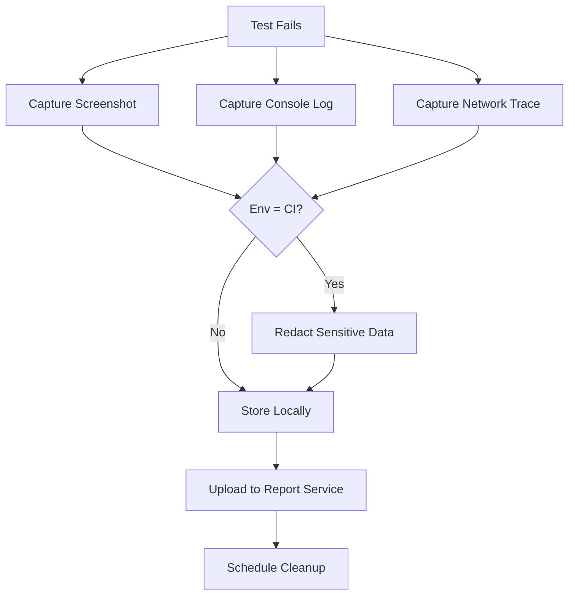

# Test Artifact Retention Policy

> **Purpose:** Define requirements for retaining screenshots, logs, and traces from failed tests
> while preventing accumulation of sensitive artifacts.
>
> **Related:** [`TESTING_GUIDE.md`](../../TESTING_GUIDE.md) · [`upload-verification-observability.md`](../operations/upload-verification-observability.md)

---

## 1. Artifact Retention Requirements

### Required Artifacts on Test Failure

| Artifact Type | Retention Scope | Storage Location |
| --- | --- | :--- |
| **Screenshots** | All test failures | `./frontend/playwright-report/screenshots/` |
| **Console logs** | All test failures | `./frontend/playwright-report/logs/` |
| **Network traces** | API-related failures | `./frontend/playwright-report/traces/` |
| **Video recordings** | Flaky tests only (optional) | `./frontend/playwright-report/videos/` |
| **Stack traces** | All exceptions | Test report + logs directory |

### Artifact Naming Convention
```
{test-suite}-{test-name}-{timestamp}-{status}.{ext}
Example: verification-workflow-fails-on-invalid-manifest-20241123T153000Z-failed.png
```

---

## 2. Retention Duration

| Artifact Type | Duration | Rationale |
| --- | :---: | --- |
| **Screenshots** | **30 days** | Sufficient for CI review and bug reporting cycles |
| **Console logs** | **30 days** | Match screenshot retention for correlated debugging |
| **Network traces** | **14 days** | Smaller footprint; trace analysis typically needed within 2 weeks |
| **Video recordings** | **7 days** | Large file size; only retain for flaky test investigation |
| **Stack traces** | **90 days** | Longer retention for pattern analysis across releases |

### Cleanup Process
- Automated cleanup runs weekly via CI cron job
- Artifacts older than retention period are deleted
- Retention applies to all environments (local, CI, staging)
- **Exception:** Security-related test failures retain artifacts for 1 year per legal hold

---

## 3. Sensitive Data Handling

### Prohibited in Artifacts
- **Authentication tokens** — redact Bearer tokens, API keys, session IDs
- **Personal identifiable information (PII)** — names, emails, addresses, phone numbers
- **Private keys or secrets** — wallet private keys, encryption keys
- **Production credentials** — database connection strings, admin passwords

### Redaction Rules
```typescript
// Example redaction patterns
const REDACTION_PATTERNS = {
  tokens: / Bearer\s+[a-zA-Z0-9\-_]+\.[a-zA-Z0-9\-_]+\.[a-zA-Z0-9\-_]+/g,
  privateKeys: /-----BEGIN\s+(RSA\s+)?PRIVATE\s+KEY-----[\s\S]*?-----END\s+(RSA\s+)?PRIVATE\s+KEY-----/g,
  passwords: /("|')?(password|secret|apiKey|token)("|')?\s*[:=]\s*("[^"]+')/gi,
  emails: /[a-zA-Z0-9._%+-]+@[a-zA-Z0-9.-]+\.[a-zA-Z]{2,}/g,
};
```

### Implementation
- Playwright config includes `onFailure` hook for artifact capture
- Global `afterEach` hook applies redaction before storage
- CI pipeline validates no secrets in artifacts before upload
- Manual review required if redaction fails

---

## 4. Artifact Upload Workflow



---

## 5. Access Control

| Role | Access Level |
| --- | :---: |
| Developers | View and download own test artifacts |
| QA Engineers | View all artifacts; download for investigation |
| Security Team | View security-related artifacts only |
| CI/CD | Write-only; no human access required |

---

## 6. Configuration

### Playwright Configuration Example
```typescript
// playwright.config.ts
export default defineConfig({
  use: {
    trace: 'retain-on-failure',
    screenshot: 'only-on-failure',
    video: 'retain-on-failure',
  },
  timeout: 30_000,
  retries: process.env.CI ? 2 : 0,
});
```

### Cleanup Script
```bash
#!/bin/bash
# cleanup-artifacts.sh
find ./frontend/playwright-report -type f -mtime +30 -delete
find ./frontend/playwright-report/traces -type f -mtime +14 -delete
find ./frontend/playwright-report/videos -type f -mtime +7 -delete
```

---

## 7. Compliance

- Retention periods align with organizational data minimization policies
- No PII retained beyond necessary debugging period
- Security incidents follow extended legal hold procedures
- Quarterly audit verifies compliance with redaction rules

---

## 8. Reference

- [`TESTING_GUIDE.md`](../../TESTING_GUIDE.md) — general testing practices
- [`upload-verification-observability.md`](../operations/upload-verification-observability.md) — upload-specific observability requirements
- [`SECURITY.md`](../../SECURITY.md) — incident response for security findings